

# Your car. On watch.

**Recording, parked surveillance and remote access for BYD.**

Use your car's cameras to record drives and watch while parked.
View live cameras and clips on the head unit, in a browser, or on your phone with Strike Connect.

[**Car APK**](https://github.com/UnrealSalty/Strike/releases/latest) &nbsp;&middot;&nbsp; [**Install guide**](docs/installation.md) &nbsp;&middot;&nbsp; [**Strike Connect**](https://strikebyd.com/pair) &nbsp;&middot;&nbsp; [**Website**](https://strikebyd.com)

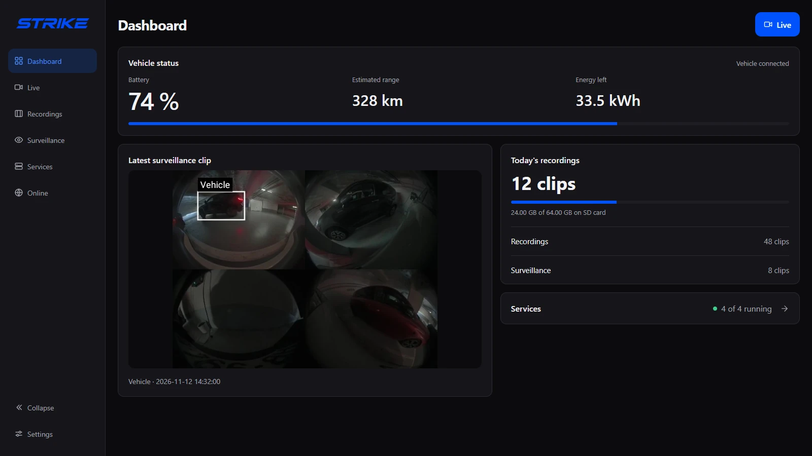

> **Release status:** The latest public car release is **v0.8**. The screenshots below preview **Strike 1.0** and **Strike Connect**, using sample data. Strike Connect is in testing; public iPhone, Google Play and Android APK downloads are **coming soon**. Check the [phone download page](https://strikebyd.com/pair) for availability.

## Features

| | What Strike does |
| --- | --- |
| **Recordings** | Record continuously when the car is on or only while driving. Choose clip length, quality, frame rate and optional cabin audio. |
| **Surveillance** | Detect people and vehicles while parked, or record continuously through the armed period. Review events on a clip timeline and optionally show a red screen deterrent. |
| **Live cameras** | Check the cameras in the car, browser or phone app. Choose a stream quality independently of recording quality. |
| **Storage** | Save to internal storage, SD or USB. Set separate recording and surveillance limits, delete clips in batches, and rotate the oldest finished clips. |
| **Phone access** | Pair without creating an account. View live cameras, play and save clips, receive alerts, and manage supported Strike settings. |
| **Browser access** | Open the car's dashboard locally, through your Cloudflare domain, or through a zrok link. |

Recording and detection run on the car. Remote access is optional.
Strike is an independent project and is not affiliated with BYD.

## Strike Connect

The separate companion app for **iPhone and Android**. It connects to Strike 1.0
through **Strike Services**. The app is named **Strike** on the phone.

<table>
<tr>
<td width="33%" align="center" valign="top">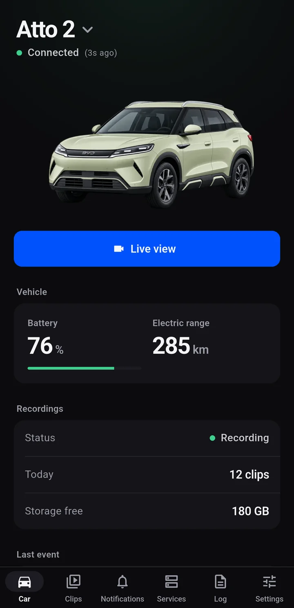 <b>Your car</b> Connection, vehicle readings and today's recordings.</td>
<td width="33%" align="center" valign="top">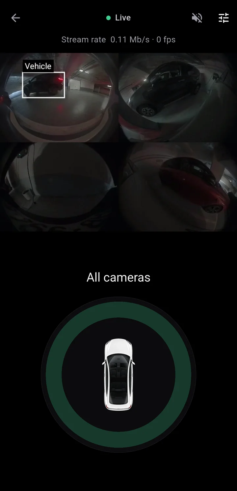 <b>Live cameras</b> Watch the car and choose a camera or stream quality.</td>
<td width="33%" align="center" valign="top">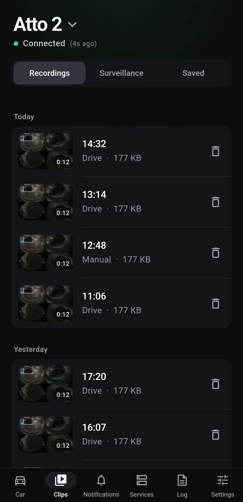 <b>Clips</b> Recordings, surveillance and saved copies in one place.</td>
</tr>
<tr>
<td width="33%" align="center" valign="top">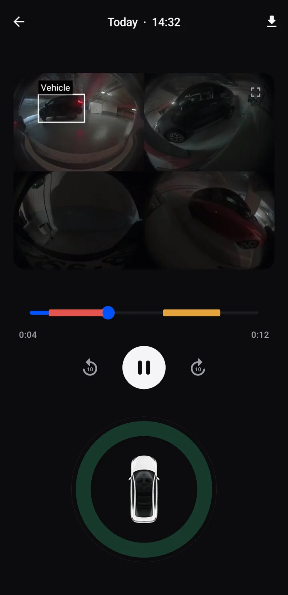 <b>Playback</b> Jump to an event, change the view and save the clip.</td>
<td width="33%" align="center" valign="top">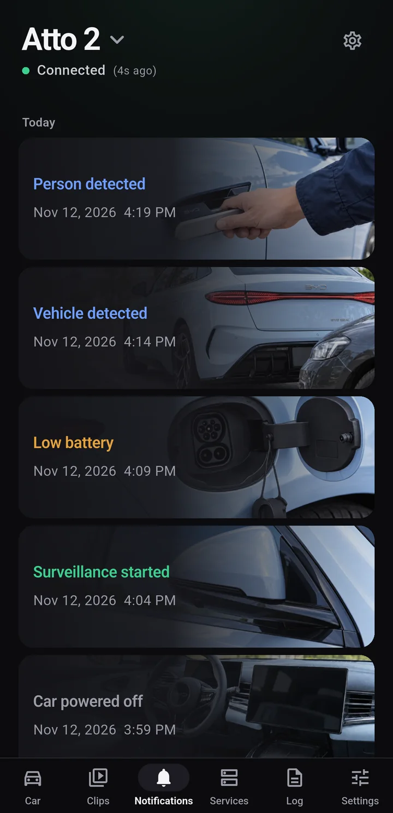 <b>Notifications</b> Choose which activity and vehicle alerts you receive.</td>
<td width="33%" align="center" valign="top">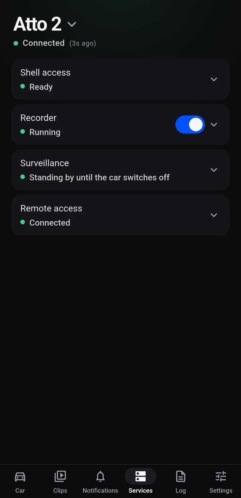 <b>Services</b> Inspect services and manage supported controls.</td>
</tr>
</table>

Android interface previews with sample data. Camera images use a replayed frame.

- **Keep clips on your phone.** Saved clips play offline, and can be exported to your gallery.
- **Read the car's logs.** Refresh, copy or export logs from your phone. Fetched logs remain cached locally.
- **Manage Strike remotely.** Recording and surveillance settings, BYD features, updates and model reports are available from the phone. Remote access itself is configured on the car.
- **Use English or French.** Both languages are supported in the car and phone interfaces.

**Pair a phone**

1. In the car, open **Online > Strike Services > Pair a phone**.
2. In the phone app, scan the QR code or enter its six-digit code.
3. If you enter the code, check the matching four-digit verification number and approve the request on the car.

Pairing codes expire. Open **Pair a phone** again when you need a fresh code.
Live access needs the car awake and online. The phone app is not a way to wake a sleeping head unit.

[**Strike Connect availability and downloads**](https://strikebyd.com/pair) &middot; [Pairing and remote-access guide](docs/usage.md#strike-connect)

## In the car

The same dashboard, recordings and surveillance libraries are available on the head unit.

<table>
<tr>
<td width="50%" valign="top">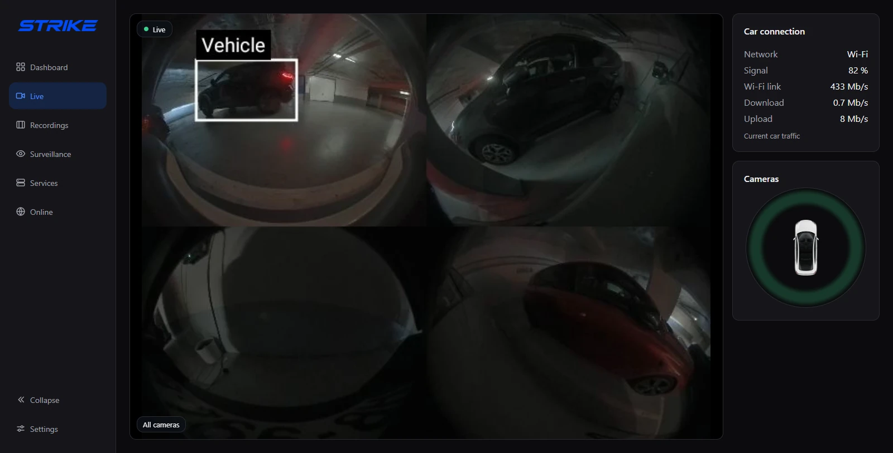 <b>Live view</b> Camera selection and connection information beside the feed.</td>
<td width="50%" valign="top">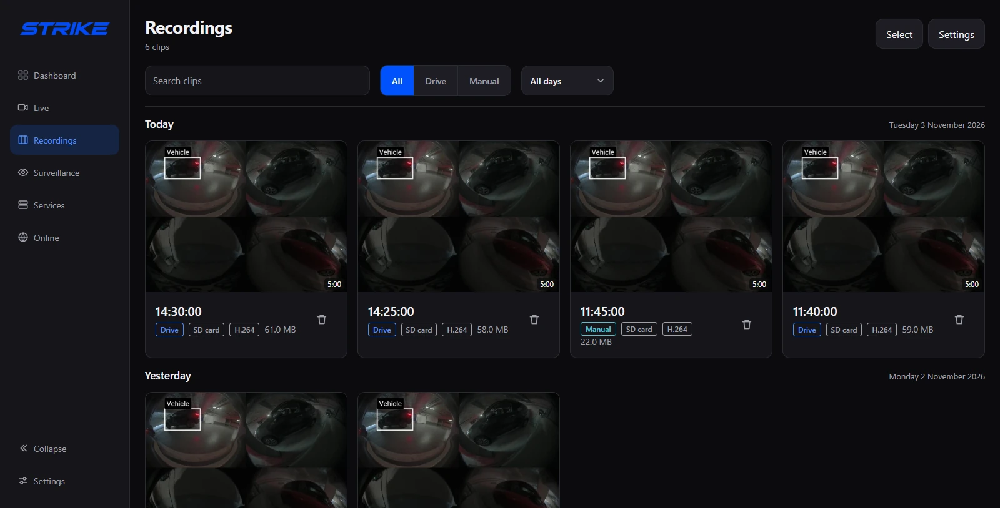 <b>Recordings</b> Browse finished clips and select several to delete.</td>
</tr>
<tr>
<td width="50%" valign="top">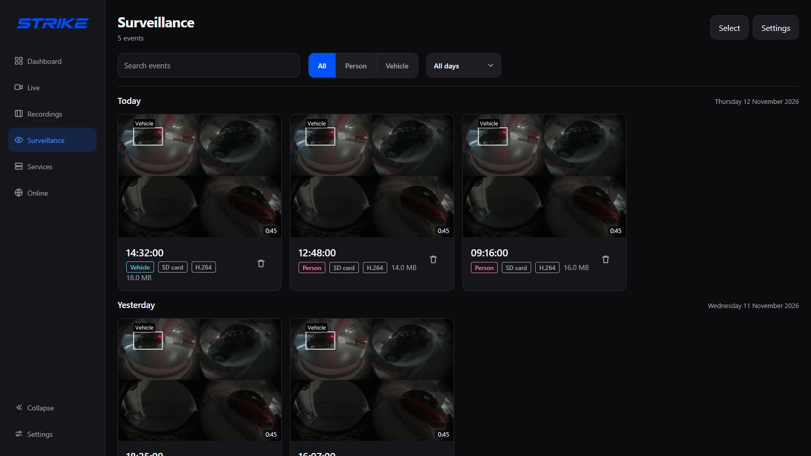 <b>Surveillance</b> Parked activity is kept separate from ordinary recordings.</td>
<td width="50%" valign="top">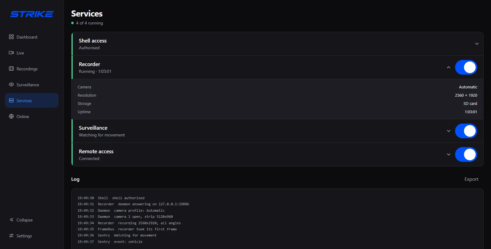 <b>Services</b> Service state, controls and logs in one place.</td>
</tr>
</table>

### Your car's cameras

On supported **360-camera vehicles**, Strike puts the four views into one clip.
Choose the full mosaic or an individual camera during live view and playback.

**Rear-camera-only vehicles** use the available rear feed. Strike 1.0 includes
rear-only detection and a **Rear camera only** profile; unavailable camera views stay disabled.
Camera equipment can differ between trims of the same model.

Start with **Automatic** in **Settings > Debug > Camera profile**. Profile changes apply
automatically in Strike 1.0, with a brief interruption while capture restarts.
See [camera and firmware compatibility](#compatibility).

## Recording while parked

**Smart** watches for movement, checks for people and vehicles, and saves event
clips with footage from before the detection. Recording continues for 20 seconds after the
last detection, splitting long events into clips of approximately two minutes.

**Continuous** records throughout the armed period. Parked surveillance has its
own storage, quality and frame-rate settings; surveillance clips do not contain cabin audio.

An optional **red screen deterrent** displays a message on the head unit.
Surveillance uses power to keep the head unit and cameras awake. Battery use and
parked operation depend on the vehicle, firmware, settings and storage.

[Surveillance setup and behaviour](docs/usage.md#parked-surveillance)

## Remote access

| Method | Use it for | Setup |
| --- | --- | --- |
| **Strike Services** | Strike Connect on iPhone or Android | Pair a phone from the car. Requires Strike 1.0. |
| **Cloudflare** | Browser access through your own domain | Configure a tunnel and hostname on the car. |
| **zrok** | Browser access through a public link | Configure zrok on the car. |
| **Local network** | A browser on the same reachable network | Open the local address shown in Online. |

Choose one remote service at a time. Browser access uses the car's **Browser access**
code; phone pairing uses Strike Services. These are separate from the optional in-car PIN.

Recordings are stored on the car. Strike Services uses a backend for pairing,
connections and requested clip transfers; it does not provide a cloud video archive.
Clips you save to your phone remain available offline.

[**Remote-access instructions**](docs/usage.md#browser-access) &middot; [Privacy policy](https://strikebyd.com/privacy)

## Get started

1. [Install the car APK through authorized ADB access](docs/installation.md).
2. Open Strike, grant permissions, and authorize **Shell access** if prompted.
3. In **Recordings > Settings**, choose a recording mode and storage. Turn **Recorder** on in **Services**.
4. Configure **Surveillance > Settings** if you want parked recording.
5. Set up **Online** for browser access, or pair Strike Connect when using Strike 1.0.

In the current public **v0.8** release, **Services** is named **Daemons** and Strike
Connect is not supported. The installation guide explains the available release and setup steps.

[**Full installation guide**](docs/installation.md) &middot; [Recording, storage and remote-access guide](docs/usage.md)

## Compatibility

The car app needs a **BYD head unit running Android 9 or newer**, **64-bit ARM**,
compatible camera and vehicle-state interfaces, and authorized **ADB on port 5555**.
Installing Strike does not enable ADB or add cameras the vehicle does not have.

Strike 1.0 includes legacy/DiLink 3, DiLink 4 and DiLink 5 camera paths. Compatibility
depends on the head unit, firmware and camera equipment, not just a model name or
DiLink label. **Atto 2 is the reference car tested by the maintainer**; other vehicles
and firmware combinations need verification. Some units need an explicit camera profile.

For camera problems, create a **Model report** under **Settings > Debug** and include
it with your Strike version and logs in a [bug report](https://github.com/UnrealSalty/Strike/issues).
A phone or emulator cannot verify the car's camera hardware.

## Guides and support

- [Install and update Strike](docs/installation.md)
- [Recording, surveillance and storage](docs/usage.md)
- [Pair Strike Connect](docs/usage.md#strike-connect)
- [Set up browser access](docs/usage.md#browser-access)
- [Discord community](https://discord.gg/DTBZRgHX3s) and [bug reports](https://github.com/UnrealSalty/Strike/issues)
- [Privacy policy](https://strikebyd.com/privacy)
- [Support development](https://buymeacoffee.com/unrealsalty)

Update, PIN recovery and optional BYD-feature controls are covered in the
[usage guide](docs/usage.md#updates-and-access-recovery).

## Project and third-party components

This public repository hosts official car releases, documentation, screenshots
and issue reports. Application development is maintained in a private repository.
The [AI detector source snapshot](ai/README.md) documents the published detector
implementation, model and build notes; its scope is explained there.

Third-party components retain their upstream licenses:

- DiLink 5 capture helper and car graphic, copyright 2026 Yash Srivastava, MIT. See [the notice](licenses/fast_cam.txt).
- Person and vehicle detection model from [Ultralytics YOLO](https://github.com/ultralytics/ultralytics), AGPL-3.0. See [the detector source snapshot](ai/README.md).
- [Cloudflare connector notices](licenses/cloudflared-notices.txt) and [zrok notices](licenses/zrok-notices.txt).
