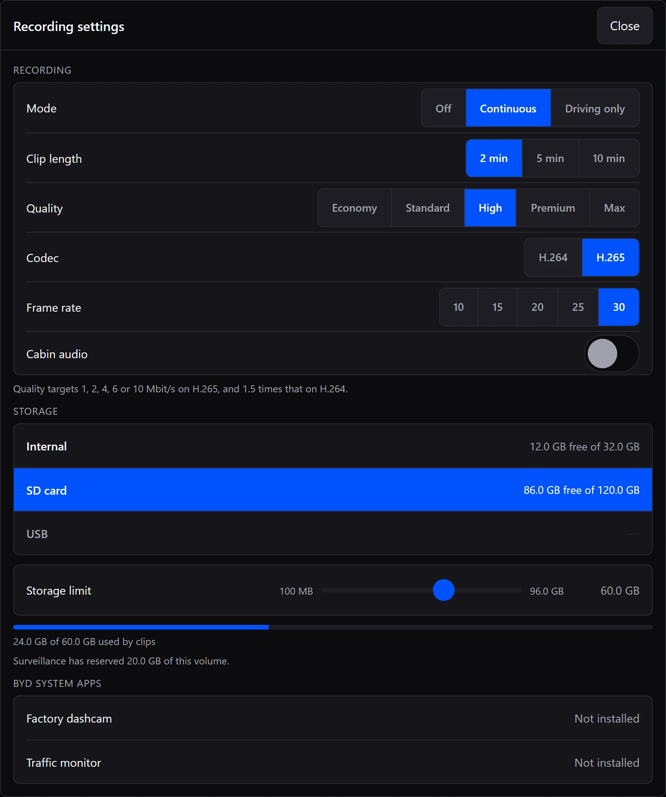
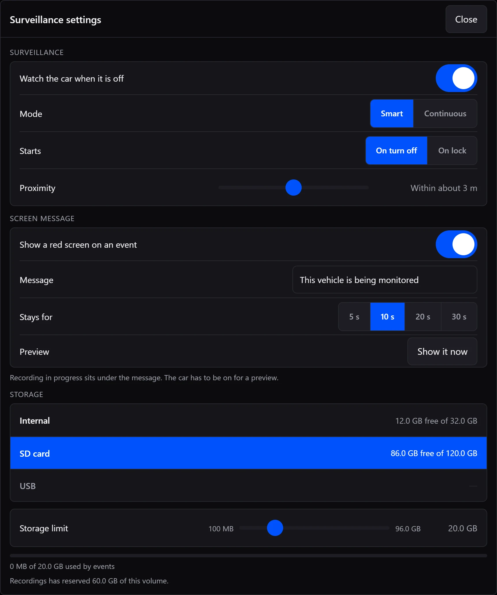

# Install Strike

[Download Strike.apk](https://github.com/UnrealSalty/Strike/releases/latest) · [Website](https://strikebyd.com) · [Back to Strike](../README.md)

This guide installs the official APK through an authorized ADB connection to the
car's head unit. It works from Windows, macOS, Linux, or an Android phone with a
network-capable ADB client.

## Before you start

- Keep the car parked and its head unit on throughout installation.
- Strike needs Android 9 or newer, 64-bit ARM, compatible cameras and ignition
  readings, and authorized local ADB on port **5555**. See [compatibility](../README.md#compatibility).
- Put the car and your computer or Android phone on the same network.
- Download **Strike.apk** from the [latest release](https://github.com/UnrealSalty/Strike/releases/latest).
  Choose the APK asset, not GitHub's source-code ZIP or TAR archive.

**ADB access must already be enabled on the head unit.** Installing Strike does
not unlock it. If access is locked, see [Strike's ADB access help](https://strikebyd.com/unlock).
The available method depends on the head unit and firmware.

ADB means Android Debug Bridge: the tool used here to connect to the head unit
and install the APK. Google provides it in [SDK Platform-Tools](https://developer.android.com/tools/releases/platform-tools);
Android Studio is not required.

## Connect and install from a computer

Download Platform-Tools for your computer and extract the ZIP. Open a terminal
in the extracted `platform-tools` folder. Find the car's IP address in its
Wi-Fi or network information.

In the commands below, replace **`CAR_IP`** with that address. Use the same
address in every command, including the `-s` device selector.

### Windows PowerShell

Connect and check the device:

```powershell
.\adb.exe connect CAR_IP:5555
.\adb.exe devices
```

If the car shows **Allow USB debugging?**, allow this computer. The prompt can
appear even though the connection is over Wi-Fi. Run `devices` again after
approving it. The car's entry must show **`device`**, not `unauthorized` or
`offline`.

Install the APK:

```powershell
.\adb.exe -s CAR_IP:5555 install -r "$HOME\Downloads\Strike.apk"
```

If you saved the APK elsewhere, replace the quoted file path with its actual
location. Wait for **`Success`**.

### macOS or Linux

Connect and check the device:

```sh
./adb connect CAR_IP:5555
./adb devices
```

Allow this computer on the car if prompted. Run `devices` again; the car's entry
must show **`device`** before installing.

```sh
./adb -s CAR_IP:5555 install -r "$HOME/Downloads/Strike.apk"
```

Replace the quoted file path if needed, and wait for **`Success`**. If you already
have `adb` on your PATH, you can use `adb` instead of `./adb`.

## Install from an Android phone

Use an ADB client that supports network connections and APK installation. Connect
to the car's IP address on port **5555**, approve the debugging prompt on the car,
then select the downloaded **Strike.apk** in the client's install action.

In a command-line client with `adb` available, the equivalent commands are:

```sh
adb connect CAR_IP:5555
adb devices
adb -s CAR_IP:5555 install -r "/sdcard/Download/Strike.apk"
```

Use the APK's actual path and grant your ADB client access to that file. Continue
only when the device is authorized and installation reports **`Success`**.

## Set up your first recording

1. Open **Strike** on the car and grant its storage and microphone permissions.
   Microphone permission alone does not start audio recording; **Cabin audio**
   is controlled in recording settings.
2. Open **Daemons**. If **Shell access** is not authorized, select **Connect** and
   accept Strike's own debugging prompt on the head unit. Approving your computer
   earlier does not approve Strike's separate connection. Initial setup restarts
   Strike once access and permissions are ready.
3. Open **Recordings → Settings**. Change **Mode** from **Off** to **Continuous**
   or **Driving only**. Choose **Storage**, **Storage limit**, and **Clip length**.
4. Open **Daemons** and turn **Recorder** on.
5. Check **Live** for the camera picture. Let a clip finish, then open it in
   **Recordings** to check playback and the selected storage.

**Continuous** records whenever the car is on. **Driving only** also needs a
confirmed driving state. Parked recording is configured separately below.



## Turn on parked surveillance

1. Open **Surveillance → Settings**.
2. Enable **Watch the car when it is off**.
3. Choose **Smart** for person and vehicle events, or **Continuous** for recording
   throughout the armed period.
4. Choose whether surveillance **Starts** on ignition off or locking, and select
   its storage and storage limit.

Keep **Recorder** enabled in **Daemons**. If the head unit has a **Disable
Autostart** list, make sure Strike is not disabled there. In a list with that
title, enabling the disable switch blocks autostart.

Test a parked session on your own car before relying on it. Head-unit sleep,
power cuts, ignition readings, and removable storage vary by firmware. See
[recording while parked](../README.md#recording-while-parked) for how Smart and
Continuous modes behave.



## Update an existing installation

In the car, use **Settings → Updates** to check, download, and install a release.
You can also download the newer official **Strike.apk** and repeat the same
`install -r` command above.

The `-r` option replaces the installed app while keeping its app data. The new
APK must use the same signing key as the installed version. Do not uninstall
Strike or clear its app data to perform a normal update: that resets its saved
settings, PIN, and browser access.

## If something fails

| What you see | What to check |
| --- | --- |
| `adb` is not recognized | Open the terminal in `platform-tools`; use `.\adb.exe` on Windows or `./adb` on macOS/Linux. |
| Connection refused or timed out | Check the current car IP, the shared network, and that ADB is enabled on port 5555. Some hotspots or guest networks block traffic between connected devices. |
| `unauthorized` | Approve the debugging prompt on the car, then run `devices` again. |
| `offline` | Disconnect and reconnect that car with `adb disconnect CAR_IP:5555` followed by `adb connect CAR_IP:5555`, using your platform's executable prefix. |
| More than one device | Keep `-s CAR_IP:5555` on the install command so it targets the car. |
| APK cannot be found | Check the download location and filename. Use a real `.apk`, not an `.apkm`, `.xapk`, ZIP, or HTML download page. |
| `INSTALL_FAILED_UPDATE_INCOMPATIBLE` | The installed app and new APK use different signing keys. Confirm the APK's source before taking any action that could erase app data. |
| Recording stays idle | Confirm **Mode** is not **Off**, **Recorder** is on, the selected storage is mounted, and the car state matches the recording or surveillance mode. |
| Camera picture is missing or split | Review [camera compatibility and profiles](../README.md#compatibility). A profile for another vehicle is not a compatibility guarantee. |

For an unresolved problem, include the car model, DiLink/Android version, Strike
version, and exact error in a [bug report](https://github.com/UnrealSalty/Strike/issues)
or [Discord](https://discord.gg/DTBZRgHX3s). Logs can be exported from **Daemons → Export**;
review them for personal details before sharing.

The connection and installation commands follow Google's [ADB documentation](https://developer.android.com/tools/adb).
