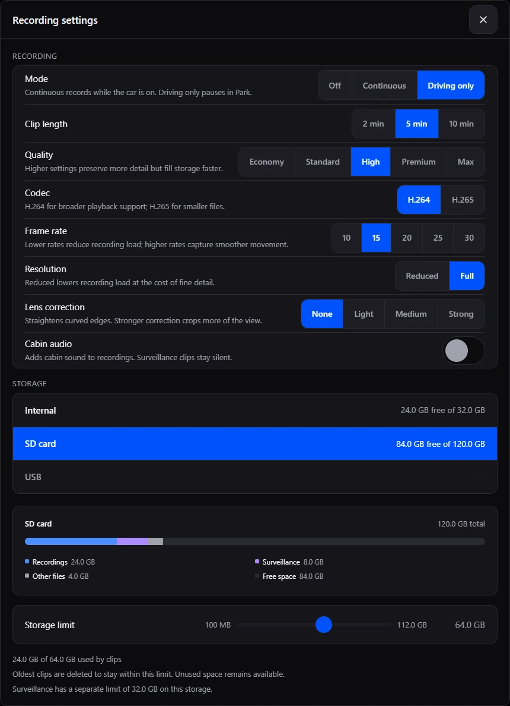
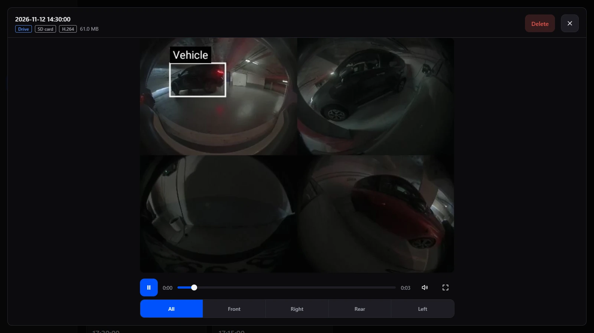
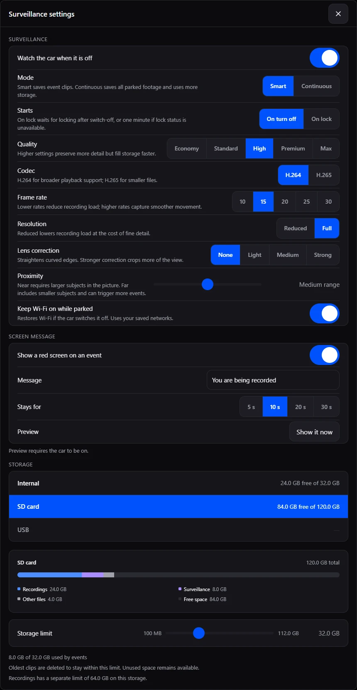
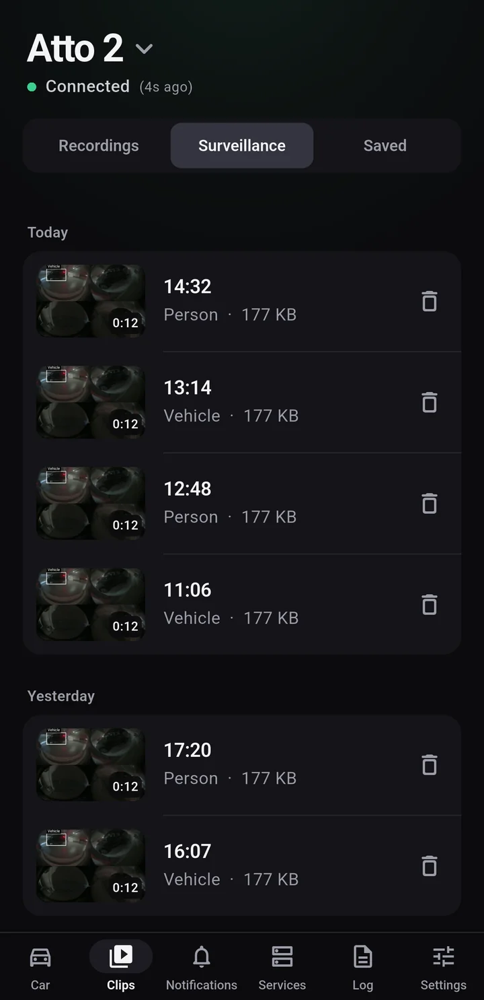
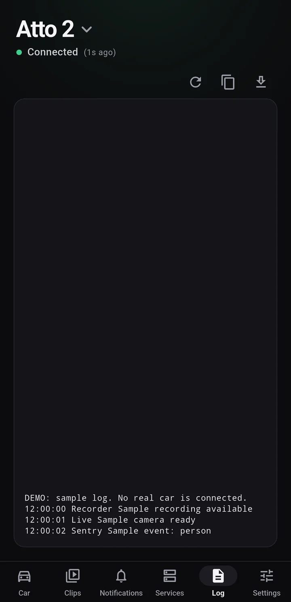
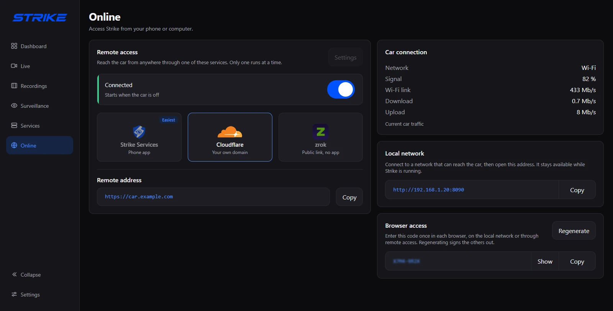

# Use Strike

[Install Strike](installation.md) &middot; [Back to the overview](../README.md)

This guide describes **Strike 1.0** and the Strike Connect phone app, currently in
testing. The latest public car release is **v0.8**; its Services page is named
**Daemons** and it does not support Strike Connect. Use the
[phone download page](https://strikebyd.com/pair) for current availability.

## Recording and storage

Open **Recordings > Settings** on the car, or **Settings > Recording** in Strike Connect.

- **Off** disables ordinary recording.
- **Continuous** records when the car is on.
- **Driving only** records when a supported driving state is confirmed.
- Choose clip length, quality, codec, resolution and frame rate for the footage you save.
- **Cabin audio** is optional for ordinary recordings. It does not add audio to surveillance clips.

Keep **Recorder** enabled in Services. A running service can be waiting for a
camera or the selected recording mode; check Live and a completed clip after setup.

Recordings and surveillance can use internal storage, SD or USB, with separate
space limits. Retention removes the oldest finished clips within those limits.
Clips still being written cannot be deleted. Use the library's selection controls
to remove several clips at once.

Changing the live-stream quality does not change the quality of saved recordings.
Codec playback support can differ between phones and browsers.





## Parked surveillance

In **Surveillance > Settings**, enable **Watch the car when it is off** and choose
when it should arm: ignition off or locking. Keep Recorder enabled.

**Smart** checks movement and confirms nearby people and vehicles before saving
an event. The clip includes a short pre-roll and continues for 20 seconds
after the last detection. Continued activity splits into clips of about two minutes.
The red screen can hide while the event clip is still recording.

**Continuous** records throughout the armed period using the configured clip
length. Surveillance has its own quality, frame rate, codec and storage settings.
Surveillance clips do not contain cabin audio.

The optional deterrent fills the head unit with red and a message you choose.
It does not operate the horn, lights, locks or other vehicle controls.

Parked capture keeps the cameras and head unit awake. Battery use varies with
the car, firmware, settings and nearby activity. A sudden power cut can leave
the clip being written incomplete. Test a parked session on your own vehicle.



## Strike Connect

Strike Connect is the separate phone app for **iPhone and Android**. The app's
display name is **Strike**. It requires Strike 1.0 on the car and uses Strike Services.
Public phone downloads are coming soon; see [availability](https://strikebyd.com/pair).

### Pairing

1. On the car, open **Online**, choose **Strike Services**, then **Pair a phone**.
2. On the phone, scan the QR code or enter its six-digit code.
3. For six-digit entry, compare the four-digit verification numbers on the car
   and phone, then approve the request on the car only if they match.

Scanning the QR code pairs directly. Pairing codes expire, so reopen the pairing
screen when you need a new one. Do not share pairing codes or QR images publicly.
No personal account registration is needed.

The car must be awake and connected for live access or to retrieve footage that
has not been saved to the phone. Strike Services cannot wake a sleeping head unit.
Set when Remote access runs on the car's Online page.

### Clips and notifications

Recordings, surveillance and saved clips have separate views. You can play a
clip from the car, save it to the phone, and export saved footage to your gallery.
A valid saved copy opens locally and remains available when the car is offline.
Surveillance playback has an event timeline.



Available alert types include people, vehicles, movement, low battery, car powered
on or off, and surveillance starting. Choose the types you want in notification
settings. Vehicle-state alerts require the corresponding readings from the car.
Push delivery also depends on platform setup and notification permission; in-app
history is separate from system push notifications. Phone releases are still in testing.

### Services and logs

**Services** shows shell access, Recorder, Surveillance and Remote access, with
expandable details and supported controls. Remote access itself is configured
on the car, so the phone cannot switch away from the service it uses to connect.

**Log** fetches the car's service log and keeps a local copy. You can refresh,
copy text or download/export the log to your phone. Cached text remains readable
while the car reconnects. Review logs for private information before sharing.



## Browser access

<a id="access-from-your-phone"></a>

On the car's **Online** page, copy a local address and open it in a browser on a
network that can reach the car. Enter the **Browser access** code shown on the car.
Regenerating that code signs out browser sessions. The in-car PIN is separate.

Local addresses use HTTP; use a trusted network. For access over the internet,
choose Cloudflare or zrok. Only one remote provider runs at a time.

In Live, choose **Auto**, **Low data**, **Balanced** or **High**. These settings
control the live stream without changing recorded clips. Network conditions and
browser codec support still affect playback.

### Cloudflare with your own domain

1. Add your domain to Cloudflare and create a dedicated Cloudflare Tunnel.
2. Copy the tunnel token from the connector installation command.
3. Add a published application route for a hostname such as `car.example.com`,
   with **HTTP** service `127.0.0.1:8090`.
4. In **Online > Cloudflare > Settings**, enter the hostname and token, choose
   when it should run, then save.
5. Turn on Remote access and open your hostname. Enter Strike's browser access code.

Use a separate tunnel for emulator testing. Sharing a tunnel token between two
running devices can send browser requests to either device.

Review [Cloudflare's video delivery policy](https://developers.cloudflare.com/fundamentals/reference/policies-compliances/delivering-videos-with-cloudflare/)
when choosing a service for live video and clip playback.

### zrok

Choose **zrok** on the car's Online page, complete its provider settings and
turn on Remote access. Open the remote address shown there and enter Strike's
browser access code. Service availability depends on the chosen provider.

### When remote access runs

Choose **Always**, **Car off** or **On lock** on the car. Automatic operation
requires the relevant ignition or lock readings. A tunnel does not wake the head
unit. The same Remote access control is also shown in Services.



## Camera profiles

Start with **Automatic** in **Settings > Debug > Camera profile**. Vehicle trims can have
different camera equipment even when their model names match.

Strike 1.0 includes rear-only detection and a **Rear camera only** profile.
A rear-only vehicle uses its rear feed; camera selections that do not exist stay
disabled. A 360-camera vehicle can show all four views in one clip or an individual view.

Legacy/DiLink 3, DiLink 4 and DiLink 5 capture paths are included. Some units need
an explicit profile. Their presence does not establish compatibility with every
head unit or firmware. The maintainer's reference vehicle is the Atto 2.

In Strike 1.0, changing a camera profile automatically restarts capture; you do
not need to manually toggle Recorder. Expect a brief interruption to recording
and live view while the camera is reacquired.

For unsupported or incorrect camera views, export a **Model report** from
**Settings > Debug** and include your model, firmware, Strike version and logs
in a [bug report](https://github.com/UnrealSalty/Strike/issues).

## BYD features

Under **Settings > BYD features**, you can turn off selected BYD head-unit apps:

- **Factory dashcam** controls BYD's DVR app (`com.byd.cdr`). The app may be
  installed even if the vehicle has no dashcam accessory.
- **Traffic monitor** controls `com.byd.trafficmonitor`.
- **Telenav navigation** controls `com.telenav.app.arp`.
- **Voice assistant wake word** controls the supported wake-word feature.

Nothing changes unless you choose it. Switch the same feature back on to restore
it. Features absent from the head unit show as not installed. These controls
require authorized shell access; they do not operate vehicle locks, climate or driving.

## Updates and access recovery

### Updates

Use **Settings > Updates** to check, download and install a car release, or use
the same authorized `adb install -r` procedure in the [installation guide](installation.md).
An update must be signed with the same key as the installed car app.

A normal update preserves app data and paired-phone credentials. Uninstalling
Strike or clearing its app data resets app identity, pairing and access credentials.
Footage stored separately on the selected recording storage is not an app backup.

### Forgotten in-car PIN

The lock screen's **Forgot PIN?** action shows recovery instructions. With an
authorized ADB connection on compatible units:

```powershell
adb shell touch /data/local/tmp/.strike_pin_reset
```

Some DiLink 5 units use another path; follow the exact command displayed by that
unit's lock screen. Reopen Strike, then set a new PIN under **Settings > Security**.
PIN recovery leaves recordings and other settings in place.

## Privacy and storage

Recording and detection run on the car. Saved phone clips and fetched logs are
kept locally. Strike Services handles pairing and connection records and forwards
requested clips through its backend; it does not store a cloud archive of footage.
Remote providers process information needed to operate their services.

Read the [privacy policy](https://strikebyd.com/privacy) for data handling, service
providers, retention and deletion details.
